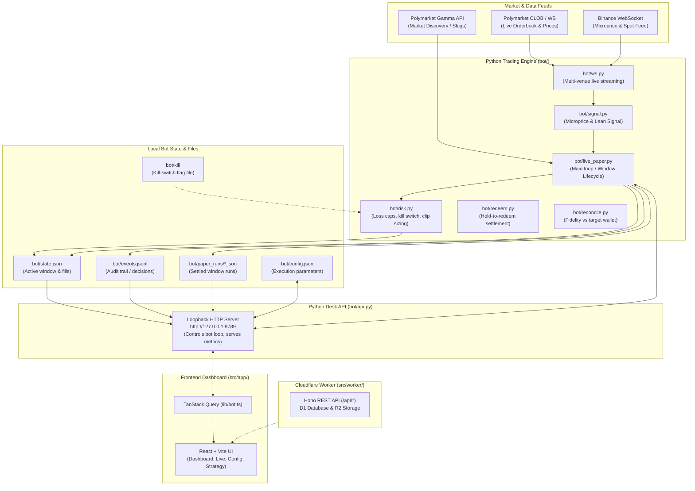

# System Architecture: dangerously-skip-permissions-bot

## Overview

This project is a **paper trading and analysis system** reverse-engineered from a target Polymarket trader (`0xc53375ff94e96100f2b30a4b5775db35218d69a9`) who trades 5-minute Bitcoin Up/Down binary options on Polymarket.

The system is split into two primary layers:
1. **The Python Paper Trading Bot & Engine** (`bot/`)
2. **The Web Desk / UI & Cloudflare Worker API** (`src/app/`, `src/worker/`)

---

## Architecture Diagram

---

## 1. Python Engine (`bot/`)

Designed as **zero live-risk / paper-only** (no private keys, loopback HTTP only):

* **`bot/live_paper.py`**: The core execution loop. Handles the 5-minute window lifecycle:
  * **Open (`openDelaySec: 13s`)**: Enters the initial clip on the leaned side.
  * **Hedge (`hedgeDelaySec: 15s`)**: Takes the opposite side for a buy-only straddle.
  * **Clipping**: Periodically adds clip sizes (`~30` shares) up to target limits (`~45` median fills/window, capped at 50 shares).
  * **Hold to Redeem**: Stops before window close (`15s`), lets the contract resolve, and credits $1/share on winning sides.
* **`bot/ws.py` & `bot/signal.py`**: Low-latency streaming of Polymarket CLOB books and Binance spot prices to compute the microprice drift / lean direction.
* **`bot/risk.py`**: Guardrails ensuring single-window execution, loss caps (`dailyLossCapUsd: 500` active when cumulative PnL breaches threshold), max USD per window, heartbeat monitoring (`updatedAtMs`), and kill-switch verification.
* **`bot/reconcile.py` & `bot/redeem.py`**: Validates execution fidelity and settlement against frozen replay records of the target wallet.

---

## 2. Desk API & Management (`bot/api.py`)

* Lightweight standard-library HTTP server running on `127.0.0.1:8789`.
* Manages the child loop process (`loop.pid`, `loop.log`).
* Exposes endpoints for bot control (`/api/bot/start`, `/api/bot/stop`, `/api/bot/kill-switch`), state streaming, config editing (`bot/config.json`), and run history analysis.

---

## 3. Frontend Trading Desk (`src/app/`)

A React 19 + Vite dashboard communicating with `bot/api.py` via `src/app/lib/bot.ts`:
* **Dashboard (`Dashboard.tsx`)**: Replay metrics, target wallet tracker, PnL charts, and fidelity comparisons.
* **Live Desk (`Live.tsx`)**: Real-time 5-minute window tracking, depth/order book, live fills, and loop status.
* **Config (`Config.tsx`)**: Parameter controls (clip sizes, delays, risk thresholds) and kill-switch toggle.
* **Strategy (`Strategy.tsx`)**: Technical breakdown of the straddle-plus-lean strategy mechanics.

---

## 4. Background CRM & Storage Layer (`src/worker/`)

Hosted on a Cloudflare Worker using Hono:
* Provides authentication, D1 SQLite database persistence, and optional R2 file storage.
* Includes routes in `src/worker/routes/bot.ts` to archive paper window runs and compare historical target wallet performance.
