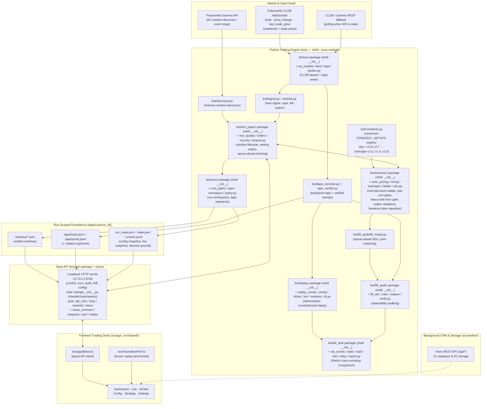

# System Architecture: dangerously-skip-permissions-bot

## Overview

This project is a **paper trading and analysis system** reverse-engineered from a target Polymarket trader (`0xc53375ff94e96100f2b30a4b5775db35218d69a9`) who trades 5-minute Bitcoin Up/Down binary options on Polymarket.

The engine is **maker-first**: it rests bids on both outcomes, tracks the queue ahead of each resting clip, and balances inventory instead of crossing the spread. Two layers do the work:

1. **The Python Paper Trading Bot & Engine** (`bot/`) — discovery, execution, fill modeling, auditing, replay, and statistics.
2. **The Web Desk** (`src/app/`, `src/shared/`) — a React dashboard that reads the engine's state through a local Desk API.

---

## Architecture Diagram

---

## 1. Python Engine (`bot/`)

Zero live-risk / paper-only (no private keys; loopback HTTP only). Every user-facing strategy string is generated from `bot/constants.py`, so the registry is the single source of truth.

* **`bot/constants.py` — `STRATEGY_SETUPS`:** the versioned setup registry, from `hapcs-v1` through `dangerously-skip-permissions` (plus `v2.6`–`v2.7`) and `hydrogen-v1.0`, `hydrogen-v1.9`, `hydrogen-v2.0`. Each setup carries its `entry` numbers (ladder levels/spacing, clip schedule, dip curve, timing, pair-cost caps, unhedged caps) and behavior flags; the UI's `signature`, `description`, and `configHighlights` are generated from them.
* **Shell + pure layout (convention):** each former god file is now a **package** whose thin **shell** (`__init__.py`) owns every patchable seam (paths, workspaces, caches, locks, network clients, `Handler`/`main`/CLI entry) and re-exports public names, plus **pure modules** that take explicit arguments and never `import bot.<shell>` (direct, deferred, or circular). `patch.object` targets on the shell keep working because the shell rebinds what the pure modules return (e.g. `patch.object(ws, "TAPE_*")`, `patch.object(executor, "select_ladder_clip")`). `bot/microstructure_engine/` and `bot/constants.py` are intentionally untouched.
* **`bot/live_paper.py` (shell) + `live_quotes/orders/records/phases.py` — window lifecycle:** discovers 5-minute windows, opens at `startAfterOpenSec`, rests and re-quotes maker ladders through the window, tracks `queue_ahead` on every clip, and stops at `stopBeforeCloseSec` to hold winning shares to redemption. Runs under `--loop`, `--once`, or a fixed `--slot`, writing into a run workspace. Pure helpers: `live_quotes` (lean/microprice probes), `live_orders` (resting-ladder updates), `live_records` (record/settlement writes), `live_phases` (setup → fill engine → sweep/exit → close).
* **`bot/executor.py` (shell) + `exec_pricing/sizing/hydrogen/ladder/sim.py` — decision engine:** evaluates the microstructure ladder against the live book, enforces `targetPairCost` / `maxPairCost` / `rescuePairCostMax` gates, keeps the lead under `maxUnhedgedShares` / `maxUnhedgedUsd`, and applies `hydrogen-v1.9`'s 3-layer architecture: Layer 1 single 5-share maker probe in 42–49¢ with T+150s / 40 sh cutoff; Layer 2 immediate sub-par clamped maker hedging (≤$0.990) with strict resting order hygiene on lead > 0.5 sh; Layer 3 patient 20s delayed taker bailout (marginal pair ≥$1.07 & ask ≤72¢) with single-window freeze latch to eliminate terminal breakout tax. Taker fills pay the parabolic fee `0.07 · p · (1 − p)`; maker fills pay zero.
* **`bot/fill_audit/fill_model.py` — queue-ahead fill model:** a resting bid fills only when a taker **SELL** print on the same outcome at or below the limit (or a complementary BUY at `1 − price`) consumes the shares queued ahead of it first. Also supports book-cross fills and labels taker fills unverifiable in paper mode.
* **`bot/fill_audit.py` (shell) + `fill_util/roles/realism/verify.py` + `bot/tape_verifier.py` — attainability auditing:** reconstructs the effective queue from `book.jsonl` snapshots with FIFO cancel credit, then judges each maker fill against `prints.jsonl` as verified / attainable / phantom. A window with no prints is unjudgeable rather than declared phantom. The Desk's "Verified Only" and "Attainable P&L" views read these verdicts live.
* **`bot/tape_recorder.py` + `bot/ws.py` (shell) + `ws_models/feed/tape/quotes.py` — tape pipeline:** the CLOB WebSocket (`book`, `price_change`, `last_trade_price`) plus REST fallback append book snapshots and trade prints to `tape/book.jsonl` and `tape/prints.jsonl`, rotating by size (128 MB book / 32 MB prints) so readers walk oldest-first and verification stays bounded.
* **`bot/replay.py` (shell) + `replay_consts/sizing/slices/sim/analysis/cli.py` — offline replay:** walks a recorded window's clock, takes quotes from `book.jsonl`, applies placement rules through the **real** `bot.executor` helpers, and books fills from `prints.jsonl` via `bot.fill_model`. It never reads a window's own fills to drive the simulation—only condition id, slug (start epoch), and winner for scoring. Invoked with `python -m bot.replay --run … --rule …`.
* **`bot/ab_test.py` (shell) + `ab_consts/stats/load/dist/meta/report.py` — statistical comparison:** compares a baseline run/setup against a candidate using Welch's one-tailed two-sample t-test (α = 0.05, 80% power, Welch–Satterthwaite df, dynamic `t_crit`), over active windows only; tracks paired-window and sub-dollar-pair gates and pair-cost buckets. Archived / tainted runs are excluded.
* **`bot/runs.py` (shell) + `runs_paths/tape/workspace/query.py` + `bot/verify_run.py` — persistence:** `RunWorkspace` owns `data/runs/<run_id>/`, provides incremental tape byte counts (so a multi-GB book is not rescanned per request), and re-stamps whole-run verdicts offline.

---

## 2. Desk API & Management (`bot/api/` package + pure view/loop/market modules)

* Thin shell (`bot/api/__init__.py` owns `Handler`/`main`, paths, run workspaces, caches, locks, network client) with pure builders in `bot/api/api_core.py` (core helpers), `bot/api/api_loop.py` (loop-process helpers), `bot/api/api_markets.py` (market math), `bot/api_views/__init__.py` (view shell) + `bot/api_views/views_common/snapshot/perf/trades.py` (dashboard builders). Pure modules take explicit arguments and never import `bot.api`.
* Lightweight standard-library HTTP server, default `127.0.0.1:8789` (`--port` overrides it; the frontend mirrors it with `VITE_BOT_ORIGIN`). On Windows, `scripts/restart_api.ps1` stops the old process/port, verifies release, respawns, and health-checks the control endpoint.
* Manages the child loop process (`loop.pid`, `loop.log`) and exposes:
  * **Control:** `GET /api/bot/control`, `GET /api/bot/snapshot`, `GET /api/bot/ws-ticks`; `POST /api/bot/start`, `/stop`, `/resume`, `/kill-switch`, `/reset`, `/select-run`, `/resume-run`, `/redeem`.
  * **Runs & audit:** `GET /api/bot/runs`, `/events`, `/trades`, `/kpis`, `/perf`, `/tape`.
  * **A/B test:** `GET /api/bot/ab-test`; `POST /api/bot/ab-test/start`, `/ab-test/stop`.
  * **Setup / config:** `GET /api/bot/strategy-setups`, `GET /api/bot/config`, `POST /api/bot/strategy-setup`, `POST /api/bot/config`. Replay itself is a CLI tool (`python -m bot.replay`), not an HTTP endpoint.

---

## 3. Frontend Trading Desk (`src/app/`, `src/shared/`)

A React 19 + Vite dashboard talking to `bot/api.py` through the typed client `src/app/lib/bot.ts` (`BOT_ORIGIN`, default `http://127.0.0.1:8789`):

* **Dashboard (`src/app/pages/Dashboard.tsx`)**: session selector with view-only past runs, KPI strip, cumulative PnL curve with rebate / Verified Only / Attainable P&L and timeframe filters, execution-health matrix, and settled-window log.
* **Live Desk (`src/app/pages/Live.tsx`)**: real-time 5-minute window tracking, CLOB depth/books, live fills, WebSocket health and pause/resume controls.
* **A/B Lab (`src/app/pages/AbTest.tsx`)**: baseline vs candidate run/setup comparison—Welch t-test tiles, rejection boundary, P&L distributions, pair-cost buckets, fee-basis toggle, and launch/stop controls for a candidate run.
* **Config (`src/app/pages/Config.tsx`)**: `STRATEGY_SETUPS` selector plus editable ladder, pair-cost, unhedged-cap, timing and risk parameters; kill-switch card.
* **Strategy (`src/app/pages/Strategy.tsx`)**: interactive explanation of resting ladders, queue-ahead fill mechanics, inventory balancing and the parabolic taker fee, using the active setup's numbers.
* **Settings (`src/app/pages/Settings.tsx`)**: account, workspace name, connection status and data reset/clear controls (general workspace settings, not bot-specific).
* **`src/shared/botPerf.ts`**: frozen 24h replay benchmark data used by the dashboard's reference comparisons.

---

## 4. Background CRM & Storage Layer (`src/worker/`)

Hosted on a Cloudflare Worker using Hono:

* Provides authentication, D1 SQLite database persistence, and optional R2 file storage.
* Includes routes in `src/worker/routes/bot.ts` to archive paper window runs and compare historical target-wallet performance.
