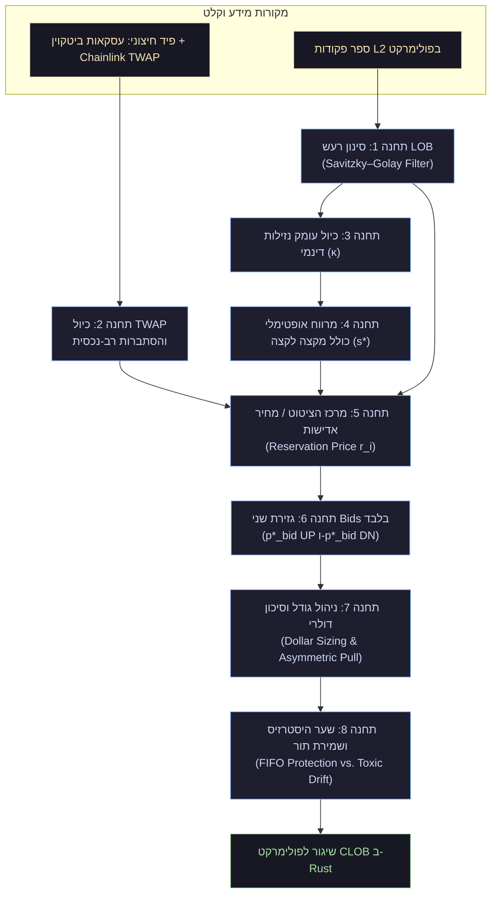

# סיכום ארכיטקטורה: מנוע Market Making וארביטראז' ב-Polymarket (5-Min BTC)

הסיכום המלא, המזוקק והמתוקן של מנוע המסחר. הקובץ מותאם ב-100% למבנה של **חוזה ביטקוין ל-5 דקות ב-Polymarket** מול מנוע חישוב מהיר ב-**Rust** (ללא הנחות שגויות של מכירה בחסר עם 0 מלאי וללא תלות בתוכניות נזילות יומיות).

---

### עקרונות היסוד שהוסכמו (Baseline Rules)

1. **התחלה עם 0 מלאי ("Everything is a Bid"):**  
   אנחנו נכנסים ללא חוזים. אי אפשר למכור (Ask) מה שאין, ולכן הבוט מציב **אך ורק פקודות רכש (Bids)** משני הצדדים במקביל: $p_{\text{bid}}^{\text{UP}}$ ו-$p_{\text{bid}}^{\text{DN}}$.

2. **מטרת הארביטראז' (Sub-1.00$ Window):**  
   רכישת צמד בעלות כוללת הנמוכה מ-1 דולר:
   $$p_{\text{bid}}^{\text{UP}} + p_{\text{bid}}^{\text{DN}} < 1.00$$
   ברגע ששני הצדדים מתמלאים, מפעילים מיזוג חוזה (`mergePositions`) לפדיון מיידי של **1.00 USDC** ברווח נעול.

3. **ללא תלות בתוכנית תגמולי נזילות (3:1 Out):**  
   שוק של 5 דקות תנודתי ומהיר מדי מכדי לצבור זמן ספר (Uptime) עבור תגמולים יומיים. הבוט נבנה לרווח ארביטראז' ומרווח נטו בלבד (לצד Maker Rebates פר-טרייד אם קיימים).

4. **חשיפת סיכון דולרית אבסולוטית (Notional Risk):**  
   הסיכון לא נמדד בכמות מניות יבשה (100 מניות ב-0.20 דולר הן סיכון של 20 דולר; ב-0.60 דולר הן סיכון של 60 דולר). תקרת הסיכון $V_{\max}$ מוגדרת בדולרים, והכמות המותרת $Q_{\max}(p)$ נגזרת ממנה:
   $$Q_{\max}(p) = \left\lfloor \frac{V_{\max}}{p} \right\rfloor$$

5. **תוצאת השוק נקבעת ב-Chainlink TWAP:**  
   השוק מוכרע לפי ממוצע משוקלל בזמן (TWAP 60s) ולא לפי טיק ספוט בודד בפקיעה, מה שמייצר שחיקת תנודתיות מצטברת ומאפשר חיזוי מתמטי עדיף ככל שחלון הזמן מתקדם.

6. **מימוש ב-Rust (Zero-Allocation Pipeline):**  
   עבודה עם `rs-clob-client-v2` ו-`tokio`, ללא מנגנון איסוף זבל (Garbage Collector), עם זמני תגובה של ננו-שניות ורציפות בזיכרון המטמון (L1/L2).

---

### הארכיטקטורה המלאה: 8 התחנות של המנוע

---

### פירוט התחנות שלב אחר שלב

#### תחנה 1: סינון רעשי מיקרו-מבנה (Savitzky–Golay Filter)
* **הקלט:** מחיר האמצע הגולמי (Raw Mid) מעדכוני ה-LOB השוטפים.
* **החישוב:** הפעלת מסנן דיגיטלי (פולינום בחלון נע) שמנקה תנודות רגעיות, פקודות מהבהבות (Flickering) ורעשי שוק מבלי לייצר פיגור (Lag) בזמן.
* **הפלט:** מחיר אמצע מסונן, יציב ואמיתי ($s_i$) שמייצג מגמה ולא רעש.

#### תחנה 2: כיול Chainlink TWAP וקורלציית נכס הבסיס
* **הקלט:** פיד עסקאות הספוט מבינאנס/בייביט ופיד ה-TWAP של Chainlink.
* **החישוב:** חישוב הממוצע המצטבר (Running TWAP) ביחס למחיר הפתיחה של החוזה, ושקלול שחיקת התנודתיות (ככל שמתקרבים לדקה ה-5, המשקל של העבר מתקבע והשפעת הספוט יורדת).
* **הפלט:** הסתברות מיקרו-מבנית מעודכנת לכיוון הסגירה של החוזה, המזינה את שונות הנכס ($\sigma^2$) והמגמה.

#### תחנה 3: כיול עומק ונזילות השוק (Order Flow Intensity $\kappa$)
* **הקלט:** ספר הפקודות ועוצמת זרימת העסקאות (Trade Arrival Rate).
* **החישוב:** גזירת עקומת דעיכת הנזילות ככל שמתרחקים ממחיר האמצע:
  $$\kappa = -\frac{\partial \ln \lambda(\delta)}{\partial \delta}$$
* **הפלט:** פרמטר עומק השוק החי ($\kappa$). אם יש בהלה בשוק והספר מתרוקן, $\kappa$ צונח מיד ומתריע על שוק דליל ומסוכן.

#### תחנה 4: חישוב רוחב המרווח האופטימלי (Optimal Full Spread $s^*$)
* **הקלט:** עומק הספר ($\kappa$) ומקדם שנאת הסיכון שלך ($\gamma$).
* **החישוב:** פתרון משוואת ה-HJB הקובע את **הרוחב האבסולוטי מקצה לקצה**:
  $$s^* = \frac{2}{\gamma} \ln \left( 1 + \frac{\gamma}{\kappa} \right)$$
* **הפלט והמשמעות:** ערך עשרוני של רוחב המרווח הכולל (למשל $s^* = 0.06$ דולר).
  * זהו המרווח המלא שחייב להתחלק ב-2 ($s^*/2 = 0.03$ דולר) כדי לקבוע את מרחק הביטחון מהאמצע.
  * בשוק רגוע, $s^*$ קטן ומאפשר לקנות צמד ב-0.99 דולר; בשוק תנודתי, $s^*$ מתרחב ודורש צמד ב-0.97 דולר ומטה לפני כניסה.

#### תחנה 5: מרכז הציטוט ומחיר האדישות (Reservation Price $r_i$)
* **הקלט:** מחיר האמצע המסונן ($s_i$), המלאי הקיים ($q$), הזמן שנותר לפקיעה ($T-t$), ומקדם שנאת הסיכון ($\gamma$).
* **החישוב:** הסטת נקודת המרכז של הבוט בהתאם לנטל החשיפה שצבר:
  $$r_i = s_i - q \cdot \gamma \sigma^2 (T - t)$$
* **הפלט:** מחיר אמצע סובייקטיבי (ערך `f64` בין 0 ל-1).
  * אם אין מלאי ($q = 0$): המרכז נשאר במחיר האמצע ($r_i = s_i$).
  * אם נקנה צד אחד ($q > 0$): המרכז נדחף הרחק למטה כדי לא לרכוש עוד מאותו צד.

#### תחנה 6: פריסת מחירי היעד כפקודות רכש בלבד (Target Bids Placement)
* **הקלט:** מחיר המרכז ($r_i$) וחצי המרווח האופטימלי ($s^*/2$).
* **החישוב:** המרת משוואת ה-Ask התאורטית לפקודת Bid של הצד המשלים:
  * פקודת רכש ל-UP:
    $$p_{\text{bid}}^{\text{UP}} = r_i - \frac{s^*}{2}$$
  * פקודת רכש ל-DN (הצד הנגדי):
    $$p_{\text{bid}}^{\text{DN}} = 1.00 - \left( r_i + \frac{s^*}{2} \right)$$
* **הפלט:** שני מחירי קנייה סופיים שמבטיחים מראש עלות צמד קטנה מ-1 דולר:
  $$p_{\text{bid}}^{\text{UP}} + p_{\text{bid}}^{\text{DN}} = 1.00 - s^* < 1.00$$

#### תחנה 7: ניהול גודל וסיכון דולרי אבסולוטי (Notional Sizing)
1. **הקלט:** תקרת סיכון דולרית מוגדרת ($V_{\max}$), מחיר החוזה, ומצב המלאי הנוכחי בכל צד.
2. **החישוב:**
   * קביעת כמות המניות המקסימלית המותרת לחשיפה חד-צדדית:
     $$Q_{\max}(p) = \left\lfloor \frac{V_{\max}}{p} \right\rfloor$$
   * **התאמת גודל הפקודה (Linear Scaling):** ככל שצד אחד מתמלא יותר, גודל ה-Bid שלו נחתך בהדרגה עד ל-0.
3. **הטיה א-סימטרית להשלמת צמד:** אם נתפס צד UP, כוח הקנייה מופנה בעדיפות עליונה לתפוס את ה-DN המשלים כדי לסגור את הסיכון ולמזג את הפוזיציה ל-USDC.

#### תחנה 8: שער ההיסטרזיס ושמירה על תור FIFO (Queue Preserver)
* **הקלט:** מחיר היעד החדש שחושב ($p_{\text{target}}$), מחיר הפקודה הפעילה שכבר נחה בספר ($p_{\text{active}}$), וסף הרגישות המינימלי ($\epsilon = 0.01$ דולר).
* **החישוב וההיגיון:**
  $$\Delta = |p_{\text{target}} - p_{\text{active}}|$$
  * **אם $\Delta < 0.01$ דולר (שברירי סנט / רעש):** $\leftarrow$ **HOLD**. לא מבטלים! שומרים על המיקום בתור ה-FIFO כדי לא לאבד קדימות מול פקודות שוק (Takers) שמגיעות לנקות את הספר.
  * **אם $\Delta \ge 0.01$ דולר (תנועת שוק מהותית):** $\leftarrow$ **CANCEL & REPLACE**. מבטלים ונסוגים אחורה או זזים קדימה כדי למנוע ספיגת עסקאות רעילות (Adverse Selection).
