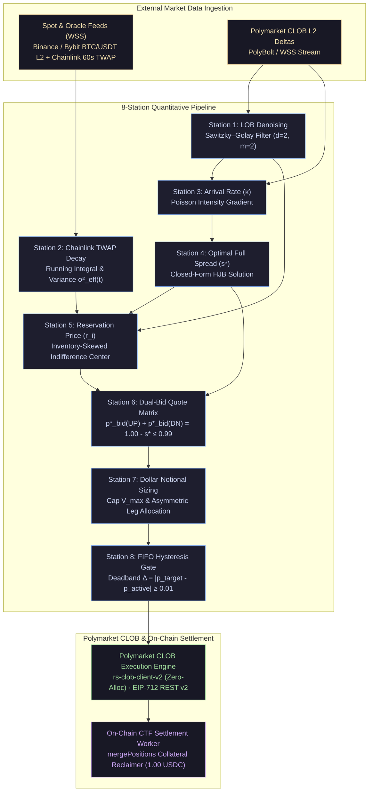
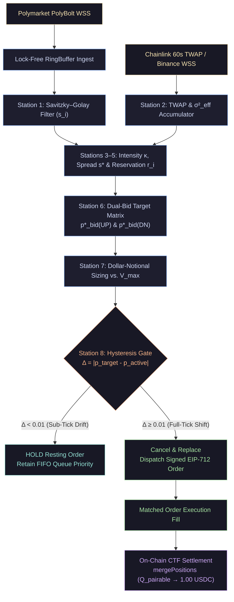

# Polymarket 5-Minute HFT Engine: Pipeline Architecture & System Overview

## 1. System Mission & Core Invariants

The quantitative objective of this high-frequency trading engine is to provide continuous, risk-minimized liquidity in **Polymarket's 5-minute Bitcoin UP/DOWN prediction series** using a microstructure-calibrated Avellaneda-Stoikov framework.

Rather than predicting directional moves in Bitcoin spot prices, the engine operates as a pure market maker and spread harvester, exploiting the structural mechanics of binary Conditional Token Framework (CTF) contracts on Polygon.

### 1.1 The Sub-$1.00 Window Arbitrage Paradigm

In binary prediction markets, outcome tokens (UP and DOWN) represent mutually exclusive, collectively exhaustive states. Under the CTF smart contract invariant, combining one share of UP with one share of DOWN guarantees immediate redemption for exactly $1.00 USDC collateral:

$$\text{Payoff}(\text{UP}) + \text{Payoff}(\text{DOWN}) \equiv 1.00\text{ USDC}$$

In the live Central Limit Order Book (CLOB), market asks reflect liquidity provider markups and discrete tick friction ($0.01\text{ USDC}$):

$$\text{Ask}(\text{UP}) + \text{Ask}(\text{DOWN}) \approx 1.01\text{ USDC}$$

An aggressive taker crossing the spread to acquire both sides immediately pays $1.01 to purchase a bundle guaranteed to pay $1.00, incurring an instantaneous loss of $0.01 per pair.

The market maker enters empty-handed ($q = 0$) and operates under an **"Everything is a Bid"** paradigm. By placing passive limit orders on both sides at prices summing to $0.99 or lower, the engine secures guaranteed net margin upon execution:

$$p_{\text{bid}}^{\text{UP}} + p_{\text{bid}}^{\text{DN}} \le 0.99\text{ USDC} < 1.00\text{ USDC}$$

Upon matched fills, the tokens are merged on-chain via the CTF contract, returning liquid USDC to the quoting pool and locking in the spread risk-free.

---

## 2. The 8-Station Pipeline Topology

The execution engine processes live order book packets through 8 specialized functional stations. The table below outlines each station, its analytical core, and links to the dedicated technical deep dives.

| Station | Module Name | Primary Objective | Mathematical Core | Deep Dive Reference |
| :--- | :--- | :--- | :--- | :--- |
| **1** | **LOB Denoising** | Filter high-frequency quote flicker without phase lag | Savitzky–Golay Polynomial Filter ($d=2, m=2$) | [Math Spec §1](./02-math-and-microstructure.md#1-station-1-lob-microstructure-denoising) · [Rust Engine §2](./03-rust-engine-implementation.md#2-station-1-savitzkygolay-filter-kernel) |
| **2** | **TWAP Decay** | Model 60s Chainlink settlement window & variance decay | Running Integral TWAP & Volatility Decay $\sigma_{\text{eff}}^2(t)$ | [Math Spec §2](./02-math-and-microstructure.md#2-station-2-chainlink-twap-resolution--variance-decay) · [Rust Engine §3](./03-rust-engine-implementation.md#3-station-2-discrete-local-twap--variance-decay-accumulator) |
| **3** | **Arrival Rate ($\kappa$)** | Calibrate real-time book depth & liquidity decay | Empirical Poisson Intensity Gradient $-\partial \ln \lambda(\delta) / \partial \delta$ | [Math Spec §3](./02-math-and-microstructure.md#3-station-3-order-flow-arrival-intensity-kappa) |
| **4** | **Optimal Spread ($s^*$)** | Compute full required spread buffer across both legs | HJB Closed-Form Spread $s^* = \frac{2}{\gamma} \ln(1 + \frac{\gamma}{\kappa})$ | [Math Spec §4](./02-math-and-microstructure.md#4-station-4-optimal-spread-derivation-s) |
| **5** | **Reservation Price ($r_i$)** | Establish inventory-penalized subjective quote center | Indifference Price $r_i = s_i - q \cdot \gamma \sigma_{\text{eff}}^2 (T - t)$ | [Math Spec §5](./02-math-and-microstructure.md#5-station-5-reservation-price--inventory-skew-r_i) |
| **6** | **Dual-Bid Matrix** | Transform theoretical Ask into complementary Bid | $p_{\text{bid}}^{\text{UP}} = r_i - \frac{s^*}{2}$, $p_{\text{bid}}^{\text{DN}} = 1.00 - (r_i + \frac{s^*}{2})$ | [Math Spec §6](./02-math-and-microstructure.md#6-station-6-dual-bid-quoting-matrix) |
| **7** | **Dollar-Notional Sizing** | Cap absolute capital risk per leg and skew sizes | Dynamic Capacity $Q_{\max}(p) = \lfloor V_{\max} / p \rfloor$ & Asymmetric Allocation | [Math Spec §7](./02-math-and-microstructure.md#7-station-7-absolute-dollar-notional-risk-management) · [Rust Engine §5](./03-rust-engine-implementation.md#5-station-7-dollar-notional-risk-engine) |
| **8** | **Hysteresis Gate** | Preserve FIFO priority while escaping toxic price drift | Native Deadband Gate $\Delta = \|p_{\text{target}} - p_{\text{active}}\| \ge 0.01$ | [Math Spec §8](./02-math-and-microstructure.md#8-station-8-queue-preservation--hysteresis-gate) · [Rust Engine §6](./03-rust-engine-implementation.md#6-station-8-fifo-hysteresis-decision-gate) |

---

## 3. High-Frequency Execution Flow & Lifecycle

The lifecycle of an order event follows a deterministic state machine:

1. **Ingestion & Denoising:** Real-time Level-2 order book updates are ingested via PolyBolt WebSockets and normalized without memory allocations. Station 1 filters out high-frequency quote flickers.
2. **Dynamic Calibration:** Stations 2, 3, and 4 compute volatility decay, order arrival intensity ($\kappa$), and the full required spread buffer ($s^*$).
3. **Dual-Bid Pricing:** Station 5 determines the subjective reservation price ($r_i$) based on unhedged exposure, while Station 6 sets the target Bids for both UP and DOWN.
4. **Risk & Queue Evaluation:** Station 7 ensures order sizes respect the absolute dollar-notional ceiling ($V_{\max}$), and Station 8 tests the update against the 1-cent hysteresis deadband ($\epsilon = 0.01$). If the market has not moved by at least one full tick, resting quotes remain untouched, preserving FIFO queue seniority.
5. **On-Chain Settlement:** When paired executions occur, the CTF settlement worker triggers `mergePositions` on Polygon to atomically redeem tokens for USDC collateral, returning capital to the active quoting balance.

---

## 4. Cross-Document Navigation

* 📐 **Mathematical Foundations:** [02-math-and-microstructure.md](./02-math-and-microstructure.md)  
  *Covers HJB derivations, TWAP variance decay integrals, Poisson intensity calculations, and asymmetric risk proofs.*
* 🦀 **Rust Systems Architecture & Official Endpoints:** [03-rust-engine-implementation.md](./03-rust-engine-implementation.md)  
  *Covers official Polymarket CLOB v2 REST/WSS endpoints, Tokio actors, zero-allocation ring buffers, SIMD filters, and EIP-712 authentication.*
* ⛓️ **On-Chain Settlement & CTF Lifecycle:** [04-ctf-settlement-lifecycle.md](./04-ctf-settlement-lifecycle.md)  
  *Covers the Conditional Token Framework, `mergePositions` transaction bundling on Polygon, gas optimization, and collateral reconciliation.*
* 🚀 **Operational Runbook, Discovery & Simulation:** [05-operational-bootstrap-and-runbook.md](./05-operational-bootstrap-and-runbook.md)  
  *Covers environment configuration, dynamic 5-minute contract discovery and rollover, paper-trading matching engine, and end-to-end `main.rs` bootstrap.*
* 📚 **Developer Bibliography & Resource Hub:** [06-developer-bibliography-and-resources.md](./06-developer-bibliography-and-resources.md)  
  *Covers the external-wallet `.env` template, repository index, contract addresses, and core references.*
* 🏛️ **Full Technical Specification:** [avellaneda-stoikov-engine-architecture.md](./avellaneda-stoikov-engine-architecture.md)  
  *Covers the complete standalone technical specification, equations, and Rust actor state model.*
* 🇮🇱 **Hebrew Architecture Overview:** [ארכיטקטורה.md](./ארכיטקטורה.md)  
  *Covers the full Hebrew specification aligned with the 8-station pipeline and execution lifecycle.*
* 🎨 **Color-Coded Math Reference:** [The-Math-for-Microstructure-Calibrated-Inventory-Risk-Engine.md](./The-Math-for-Microstructure-Calibrated-Inventory-Risk-Engine.md)  
  *Covers the annotated 8-station equations with input/output breakdowns and semantic color coding.*
