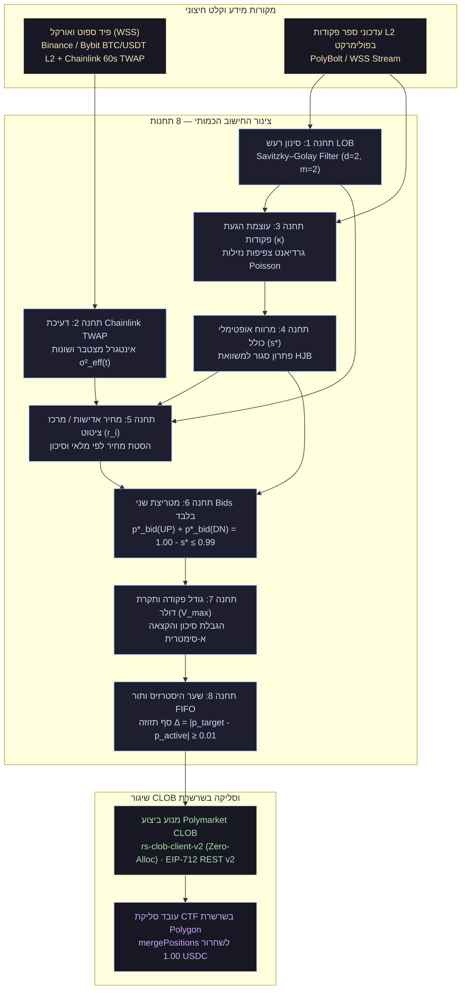
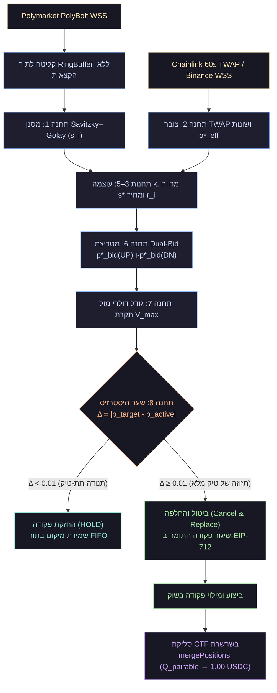

# סיכום ארכיטקטורה: מנוע Market Making וארביטראז' ב-Polymarket (5-Min BTC)

## 1. ייעוד המערכת ועקרונות היסוד (System Mission & Core Invariants)

המנוע מספק נזילות רציפה ומבוקרת סיכון בסדרת חוזי הביטקוין ל-5 דקות (UP/DOWN) ב-Polymarket. המודל מבוסס על מסגרת Avellaneda-Stoikov המותאמת למיקרו-מבנה של שווקי חיזוי בינאריים.

המנוע אינו חוזה את כיוון מחיר הביטקוין. הוא פועל כעושה שוק טהור (Market Maker) שלוכד מרווחים מתוך המכניקה המבנית של חוזי CTF על רשת Polygon.

### 1.1 פרדיגמת הארביטראז' מתחת ל-1.00 דולר (The Sub-\$1.00 Window Paradigm)

בשווקי חיזוי בינאריים, אסימוני התוצאה (UP ו-DOWN) מייצגים מצבים משלימים וזרים הדדית. החזקת יחידה אחת של UP ויחידה אחת של DOWN מבטיחה פדיון מיידי של 1.00 USDC בחוזה ה-CTF:

$$\text{Payoff}(\text{UP}) + \text{Payoff}(\text{DOWN}) \equiv 1.00\text{ USDC}$$

בספר הפקודות המרכזי (CLOB), מחירי ההיצע (Asks) מגלמים עמלת מרווח וחיכוך טיק בדיד של 0.01 USDC:

$$\text{Ask}(\text{UP}) + \text{Ask}(\text{DOWN}) \approx 1.01\text{ USDC}$$

קונה אגרסיבי שחוצה את המרווח משלם 1.01 דולר על חבילה שמחזירה 1.00 דולר, וסופג הפסד מיידי של 0.01 דולר לזוג.

המנוע מתחיל ללא מלאי ($q = 0$) ופועל תחת העיקרון **"הכול הוא פקודת רכש" ("Everything is a Bid")**. המנוע מציב פקודות Limit Buy פסיביות בשני הצדדים במחיר כולל של 0.99 דולר או פחות:

$$p_{\text{bid}}^{\text{UP}} + p_{\text{bid}}^{\text{DN}} \le 0.99\text{ USDC} < 1.00\text{ USDC}$$

לאחר שתי עסקאות משלימות, המנוע ממזג את האסימונים בשרשרת ומשחרר 1.00 USDC נזיל ללא סיכון כיווני.

### 1.2 ששת עקרונות היסוד (Baseline Rules)

1. **התחלה עם 0 מלאי ("Everything is a Bid"):**
   המנוע נכנס ללא חוזים ואינו מוכר בחסר. הוא מציב אך ורק פקודות רכש (Bids) משני הצדדים: $p_{\text{bid}}^{\text{UP}}$ ו-$p_{\text{bid}}^{\text{DN}}$.

2. **לכידת מרווח נעול מתחת ל-1.00 דולר:**
   המנוע רוכש צמד בעלות כוללת הנמוכה מ-1.00 דולר ($p_{\text{bid}}^{\text{UP}} + p_{\text{bid}}^{\text{DN}} \le 0.99$). לאחר המילוי, הפונקציה `mergePositions` פודה מיידית 1.00 USDC.

3. **אי-תלות בתוכנית תגמולי נזילות יומיים (3:1 Out):**
   שוק של 5 דקות תנודתי ומהיר מדי לצבירת זמן ספר (Uptime) עבור תגמולים יומיים. המנוע מכוון לרווחי ארביטראז' ומרווח נטו בלבד.

4. **חשיפת סיכון דולרית אבסולוטית ($V_{\max}$):**
   הסיכון נמדד בדולרים ולא בכמות מניות יבשה. 100 חוזים ב-0.20 דולר מסכנים 20 דולר, לעומת 60 דולר במחיר 0.60 דולר. הכמות המותרת נגזרת מתקרת $V_{\max}$:
   $$Q_{\max}(p) = \left\lfloor \frac{V_{\max}}{p} \right\rfloor$$

5. **הכרעת השוק לפי Chainlink 60s TWAP:**
   החוזה מוכרע לפי ממוצע משוקלל בזמן של 60 שניות אחרונות, ולא לפי מחיר ספוט רגעי בפקיעה. מנגנון זה שוחק את השונות האפקטיבית $\sigma_{\text{eff}}^2(t)$ ככל שהפקיעה מתקרבת.

6. **מימוש דטרמיניסטי ב-Rust (Zero-Allocation Pipeline):**
   המערכת רצה על `tokio` ו-`rs-clob-client-v2` ללא איסוף זבל וללא הקצאות דינמיות בנתיב הקריטי. מבני הנתונים יושבים בזיכרון המטמון (L1/L2) ומשלימים מחזור תמחור בפחות מ-50 ננו-שניות.

---

## 2. טופולוגיית 8 התחנות של המנוע (The 8-Station Pipeline Topology)



הטבלה להלן מסכמת את שמונה התחנות, מטרתן, הליבה המתמטית שלהן והקישור למסמכי ההעמקה:

| תחנה | שם המודול | מטרה מרכזית | ליבה מתמטית | קישור להעמקה |
| :--- | :--- | :--- | :--- | :--- |
| **1** | **סינון רעש LOB** | ניקוי הבהובי ציטוטים ללא פיגור פאזה | מסנן פולינום Savitzky–Golay ($d=2, m=2$) | [Math Spec §1](./02-math-and-microstructure.md#1-station-1-lob-microstructure-denoising) · [Rust Engine §2](./03-rust-engine-implementation.md#2-station-1-savitzkygolay-filter-kernel) |
| **2** | **דעיכת TWAP** | מידול חלון 60 השניות ושחיקת השונות | אינטגרל TWAP מצטבר ודעיכה $\sigma_{\text{eff}}^2(t)$ | [Math Spec §2](./02-math-and-microstructure.md#2-station-2-chainlink-twap-resolution--variance-decay) · [Rust Engine §3](./03-rust-engine-implementation.md#3-station-2-discrete-local-twap--variance-decay-accumulator) |
| **3** | **עוצמת הגעה ($\kappa$)** | כיול עומק הספר ורגישות המילוי | גרדיאנט עוצמת Poisson $-\partial \ln \lambda(\delta) / \partial \delta$ | [Math Spec §3](./02-math-and-microstructure.md#3-station-3-order-flow-arrival-intensity-kappa) |
| **4** | **מרווח אופטימלי ($s^*$)** | חישוב חיץ המרווח המלא משני הצדדים | פתרון HJB סגור $s^* = \frac{2}{\gamma} \ln(1 + \frac{\gamma}{\kappa})$ | [Math Spec §4](./02-math-and-microstructure.md#4-station-4-optimal-spread-derivation-s) · [Rust Engine §4](./03-rust-engine-implementation.md#4-station-46-pricing-engine--dual-bid-generation) |
| **5** | **מחיר אדישות ($r_i$)** | קביעת מרכז הציטוט הסובייקטיבי לפי מלאי | $r_i = s_i - q \cdot \gamma \sigma_{\text{eff}}^2 (T - t)$ | [Math Spec §5](./02-math-and-microstructure.md#5-station-5-reservation-price--inventory-skew-r_i) · [Rust Engine §4](./03-rust-engine-implementation.md#4-station-46-pricing-engine--dual-bid-generation) |
| **6** | **מטריצת Dual-Bid** | המרת מחיר Ask תאורטי לפקודת Bid משלימה | $p_{\text{bid}}^{\text{UP}} = r_i - \frac{s^*}{2}$, $p_{\text{bid}}^{\text{DN}} = 1.00 - (r_i + \frac{s^*}{2})$ | [Math Spec §6](./02-math-and-microstructure.md#6-station-6-dual-bid-quoting-matrix) · [Rust Engine §4](./03-rust-engine-implementation.md#4-station-46-pricing-engine--dual-bid-generation) |
| **7** | **תקרת סיכון דולרית** | הגבלת סיכון דולרי לרגל ותעדוף השלמת צמד | $Q_{\max}(p) = \lfloor V_{\max} / p \rfloor$ והתאמה ליניארית | [Math Spec §7](./02-math-and-microstructure.md#7-station-7-absolute-dollar-notional-risk-management) · [Rust Engine §5](./03-rust-engine-implementation.md#5-station-7-dollar-notional-risk-engine) |
| **8** | **שער היסטרזיס** | שמירת קדימות FIFO ובריחה מתנועת מחיר רעילה | סף תגובה בדיד $\Delta = \|p_{\text{target}} - p_{\text{active}}\| \ge 0.01$ | [Math Spec §8](./02-math-and-microstructure.md#8-station-8-queue-preservation--hysteresis-gate) · [Rust Engine §6](./03-rust-engine-implementation.md#6-station-8-fifo-hysteresis-decision-gate) |

---

## 3. פירוט התחנות שלב אחר שלב (Station-by-Station Specification)

### תחנה 1: סינון רעשי מיקרו-מבנה (`Savitzky–Golay Filter`)

ספרי פקודות בתדירות גבוהה סובלים מהבהובים וביטולים מהירים שאינם משקפים שינוי אמיתי בשווי ההוגן. המנוע מסנן את רעשי התדירות הגבוהה בעזרת רגרסיית פולינום מקומית של Savitzky–Golay ($d=2, m=2$).

המסנן מתאים פולינום מדרגה $d=2$ על חלון נע של $2m + 1 = 5$ דגימות, במרווחי זמן של 100 מילי-שניות:

$$p_{\text{mid}}(\tau) = \sum_{k=0}^d a_k \tau^k, \quad \tau \in [-m, m]$$

החישוב במרכז החלון מתמצמם לקונבולוציה ליניארית עם משקולות קבועים מראש:

$$s_i(t) = \sum_{j=-m}^m c_j \cdot p_{\text{mid}}(t + j)$$

```rust
// Pre-computed Savitzky-Golay coefficients for window size = 5, degree = 2
const SG_WEIGHTS_M2_D2: [f64; 5] = [-0.085714, 0.342857, 0.485714, 0.342857, -0.085714];

#[inline(always)]
pub fn filter_mid_price(window: &[f64; 5]) -> f64 {
    let mut filtered = 0.0;
    for i in 0..5 {
        filtered += SG_WEIGHTS_M2_D2[i] * window[i];
    }
    filtered
}
```

הפלט $s_i$ משמש מחיר אמצע נקי מרעש עבור כל התחנות הבאות, ושומר על נקודות המפנה ללא פיגור.

---

### תחנה 2: דינמיקת Chainlink TWAP ודעיכת השונות (`Chainlink TWAP & Variance Decay`)

חוזי הביטקוין ל-5 דקות מוכרעים לפי ה-TWAP בן 60 השניות של Chainlink Data Streams בחלון $[T - 60\text{s}, T]$. המנוע משווה ממוצע זה למחיר הפתיחה $S(t_0)$ שנקבע בתחילת החלון:

$$\text{Resolution} = \begin{cases} \text{UP}, & \text{if } \text{TWAP}_{[T-60\text{s}, T]} \ge S(t_0) \\ \text{DOWN}, & \text{if } \text{TWAP}_{[T-60\text{s}, T]} < S(t_0) \end{cases}$$

צובר ה-TWAP השוטף מתעדכן ברציפות לפי האינטגרל המצטבר של מחיר הנכס:

$$\text{TWAP}(t) = \frac{1}{t - t_{\text{start}}} \int_{t_{\text{start}}}^t S(u) \, du$$

ככל שהזמן $t$ מתקרב לפקיעה $T$, העבר כבר ננעל בתוך הממוצע והשפעת הספוט יורדת. לכן, השונות האפקטיבית קטנה בריבוע הזמן הנותר:

$$\sigma_{\text{eff}}^2(t) = \sigma_{\text{spot}}^2 \cdot \left(\frac{T - t}{T}\right)^2$$

נוסחה זו מזינה את קנס המלאי בתחנה 5 ומונעת תגובת יתר לקפיצות ספוט מאוחרות ב-Binance.

---

### תחנה 3: כיול עוצמת הגעת פקודות ונזילות (`Order Flow Arrival Intensity κ`)

הסתברות המילוי של פקודת Limit במרחק $\delta$ ממחיר האמצע דועכת באופן מעריכי:

$$\lambda(\delta) = A e^{-\kappa \delta}$$

המנוע אומד את פרמטר העומק $\kappa$ בזמן אמת מתוך צפיפות הנזילות הלוגריתמית בספר הפקודות L2:

$$\kappa = -\frac{\partial \ln \Lambda(\delta)}{\partial \delta} \approx \frac{\ln(V_1) - \ln(V_k)}{\delta_k - \delta_1}$$

* **ערך $\kappa$ גבוה ($\kappa \to \infty$):** ספר פקודות עמוק ויציב, ולכן המנוע יכול להצר את המרווח.
* **ערך $\kappa$ נמוך ($\kappa \to 0$):** ספר דליל בסיכון רעיל גבוה, ולכן המנוע מרחיק את הציטוטים.

---

### תחנה 4: חישוב רוחב המרווח האופטימלי (`Optimal Full Spread s*`)

תחנה 4 קובעת את רוחב המרווח האופטימלי הכולל $s^*$ תחת פונקציית תועלת CARA ומקדם שנאת הסיכון $\gamma$. פתרון משוואת HJB נותן נוסחה אנליטית סגורה:

$$s^* = \frac{2}{\gamma} \ln\left(1 + \frac{\gamma}{\kappa}\right)$$

המלאי הקיים $q$ אינו מופיע בנוסחה זו, כי המלאי מזיז את מרכז הציטוט ולא את רוחבו.

הערך $s^*$ מבטא את המרווח המלא מקצה לקצה (לדוגמה, $s^* = 0.06$ דולר). לפני הצבת הפקודות, המנוע מחלק אותו לשני חצאי מרווח סימטריים של $\frac{s^*}{2} = 0.03$ דולר.

---

### תחנה 5: מרכז הציטוט ומחיר האדישות (`Reservation Price r_i`)

מחיר האדישות $r_i$ מגדיר את מרכז התמחור הסובייקטיבי של המנוע בהתאם למלאי הנקי הפתוח $q$:

$$r_i(s_i, q, t) = s_i - q \cdot \gamma \sigma_{\text{eff}}^2 (T - t)$$

הסטת המרכז פועלת בשלושה מצבים:

* **מלאי מאוזן ($q = 0$):** מתקיים $r_i = s_i$, ומרכז הציטוט יושב בדיוק על מחיר האמצע המסונן.
* **עודף UP ($q > 0$, Long UP):** מתקיים $r_i < s_i$. המנוע מוריד את הצעת הקנייה ל-UP ומושך את ההצעה הנגדית קרוב יותר לשוק.
* **עודף DOWN ($q < 0$, Long DOWN):** מתקיים $r_i > s_i$. המנוע מעלה את מרכז הציטוט ומצמצם רכישות נוספות של DOWN.

---

### תחנה 6: פריסת מטריצת Dual-Bid (`Dual-Bid Quote Matrix`)

בגלל חוסר מלאי ראשוני, המנוע ממיר את משוואת ה-Ask התאורטית לפקודת Bid על הצד המשלים:

$$p_{\text{bid}}^{\text{UP}} = r_i - \frac{s^*}{2}$$

$$p_{\text{ask}}^{\text{UP}} = r_i + \frac{s^*}{2} \iff p_{\text{bid}}^{\text{DN}} = 1.00 - \left(r_i + \frac{s^*}{2}\right)$$

חיבור שני מחירי הרכש מוכיח מתמטית כי עלות הצמד נמוכה מ-1.00 דולר בדיוק בגובה המרווח $s^*$:

$$p_{\text{bid}}^{\text{UP}} + p_{\text{bid}}^{\text{DN}} = \left(r_i - \frac{s^*}{2}\right) + \left(1.00 - r_i - \frac{s^*}{2}\right) = 1.00 - s^* < 1.00\text{ USDC}$$

לדוגמה, כאשר $s^* = 0.04$, סכום שתי פקודות הרכש עומד על 0.96 דולר ומבטיח מרווח גולמי של 0.04 דולר לזוג.

---

### תחנה 7: גודל פקודה ותקרת סיכון דולרית (`Dollar-Notional Sizing V_max`)

ספירת כמות מניות קבועה יוצרת עיוות סיכון קיצוני בחוזים בינאריים. המנוע קובע תקרת הון דולרית מקסימלית $V_{\max}$ לכל רגל, וממנה גוזר את כמות החוזים המותרת:

$$Q_{\max}(p) = \left\lfloor \frac{V_{\max}}{p} \right\rfloor$$

עבור תקרה של $V_{\max} = \$50.00$:
* **במחיר 0.20 דולר:** הקיבולת המרבית היא $Q_{\max} = \lfloor 50.00 / 0.20 \rfloor = 250$ חוזים.
* **במחיר 0.60 דולר:** הקיבולת המרבית מצטמצמת ל-$Q_{\max} = \lfloor 50.00 / 0.60 \rfloor = 83$ חוזים.

גודל הפקודה הנשלחת לספר דועך ליניארית ככל שההון הפתוח ברגל מתקרב ל-$V_{\max}$:

$$\text{Size}_{\text{bid}}(p) = \text{Size}_{\text{base}} \times \max\left(0, \; 1 - \frac{q_{\text{leg}} \cdot p}{V_{\max}}\right)$$

אם רגל UP מתמלאת ראשונה, המנוע מקטין את גודל ה-Bid שלה ומפנה עדיפות לרגל DOWN להשלמת הצמד.

---

### תחנה 8: שמירת תור FIFO ושער ההיסטרזיס (`FIFO Queue Preservation & Hysteresis Gate`)

ביטול פקודה והחלפתה מאפסים את המיקום בתור ה-FIFO שבמחיר הטיק. לכן, המנוע מסנן תנודות תת-טיק ומשנה פקודה קיימת רק בחציית סף ההיסטרזיס $\epsilon = 0.01\text{ USDC}$:

$$\Delta = |p_{\text{target}} - p_{\text{active}}|$$

$$\text{Action} = \begin{cases} \text{HOLD}, & \text{if } \Delta < \epsilon \\ \text{CANCEL\_AND\_REPLACE}, & \text{if } \Delta \ge \epsilon \end{cases}$$

```rust
pub fn evaluate_order_update(active_bid: Option<f64>, target_bid: f64, epsilon: f64) -> OrderAction {
    match active_bid {
        Some(active) => {
            let displacement = (target_bid - active).abs();
            if displacement >= epsilon {
                OrderAction::CancelAndReplace { new_price: target_bid }
            } else {
                OrderAction::Hold
            }
        }
        None => OrderAction::SubmitNew { price: target_bid }
    }
}
```

* **תנודה זעירה ($\Delta < 0.01$):** המנוע שומר על הפקודה הקיימת (**HOLD**) ומגן על הקדימות בתור ה-FIFO.
* **תזוזה מהותית ($\Delta \ge 0.01$):** המנוע מבטל ומחליף מיד (**CANCEL_AND_REPLACE**) כדי להימנע ממילוי רעיל (Adverse Selection).

---

## 4. מחזור חיי הביצוע וסליקת CTF בשרשרת (Execution Lifecycle & On-Chain Settlement)

מחזור החיים של עדכון שוק פועל כמכונת מצבים דטרמיניסטית מקצה לקצה:



1. **קליטה וסינון רעש:** עדכוני L2 נכנסים מ-PolyBolt ל-RingBuffer ללא הקצאת זיכרון, ותחנה 1 מסננת הבהובים.
2. **כיול דינמי:** תחנות 2, 3 ו-4 מחשבות דעיכת שונות, עוצמת זרימה ($\kappa$) ואת רוחב המרווח הנדרש ($s^*$).
3. **תמחור Dual-Bid:** תחנה 5 מחשבת את מחיר האדישות ($r_i$) ותחנה 6 גוזרת את מחירי היעד ל-UP ול-DOWN.
4. **ניהול סיכון ותור:** תחנה 7 כופה את תקרת $V_{\max}$, ותחנה 8 שומרת על התור כל עוד הסטייה קטנה מסנט.
5. **סליקת CTF אטומית בשרשרת:** ברגע שנצברות יחידות תואמות משני הצדדים, עובד הסליקה מנטר את הכמות הניתנת למיזוג:

$$Q_{\text{pairable}} = \min\left(q_{\text{UP}}, \; q_{\text{DN}}\right)$$

כאשר $Q_{\text{pairable}} > 0$, המנוע שולח עסקה לחוזה ה-CTF של Polymarket ברשת Polygon בכתובת `0x4D97DCdE725A8964c18F938002996A407217E759`:

```solidity
function mergePositions(
    IERC20 collateralToken,
    bytes32 parentCollectionId,
    bytes32 conditionId,
    uint[] calldata partition,
    uint amount
) external;
```

הקריאה ממירה $Q_{\text{pairable}}$ אסימוני UP ו-DOWN חזרה ל-$Q_{\text{pairable}} \times 1.00\text{ USDC.e}$ נזיל ומחזירה את ההון לפעילות.

---

## 5. ארכיטקטורת Actors ב-Rust וניווט במסמכי הסדרה (Rust Architecture & Cross-Document Navigation)

מערכת ההפקה מפרידה בין קלט-פלט אסינכרוני לבין חישוב מתמטי טהור על פני ארבעה `tokio` Actors מבודדים:

1. **Market Ingestion Actors:** קולטים זרמי WebSocket מ-Binance, Bybit ו-Polymarket ודוחפים אותם לערוצי `tokio::sync::mpsc::channel` תחומים.
2. **Quantitative Engine Actor:** מריץ ברצף את תחנות 1 עד 6 על מערכים קבועים מראש (`[f64; N]`) עם אפס הקצאות זיכרון.
3. **Risk & Order Lifecycle Actor:** מריץ את תחנות 7 ו-8 ומשגר פקודות חתומות ב-EIP-712 דרך `rs-clob-client-v2` רק בחציית סף ההיסטרזיס.
4. **Settlement Worker:** מאזין לאירועי מילוי ומפעיל מיזוגי `mergePositions` בשרשרת בכל פעם שמתקיים $Q_{\text{pairable}} > 0$.

מצב המנוע נשמר במבנה נתונים רציף בזיכרון המטמון:

```rust
#[repr(C)]
pub struct EngineState {
    pub gamma: f64,
    pub kappa: f64,
    pub sigma_eff_sq: f64,
    pub notional_max_usd: f64,
    pub hysteresis_epsilon: f64,
    pub inventory_up: f64,
    pub inventory_dn: f64,
    pub active_bid_up: Option<f64>,
    pub active_bid_dn: Option<f64>,
}
```

### ניווט במסמכי הסדרה באנגלית

* 📖 **סקירת צינור וטופולוגיה:** [01-pipeline-overview.md](./01-pipeline-overview.md)
* 📐 **יסודות מתמטיים ומיקרו-מבנה:** [02-math-and-microstructure.md](./02-math-and-microstructure.md)
* 🦀 **מימוש המנוע ב-Rust ונקודות קצה רשמיות:** [03-rust-engine-implementation.md](./03-rust-engine-implementation.md)
* ⛓️ **מחזור חיי סליקה ומיזוג ב-CTF:** [04-ctf-settlement-lifecycle.md](./04-ctf-settlement-lifecycle.md)
* 🚀 **מדריך הפעלה, גילוי שווקים וסימולציה:** [05-operational-bootstrap-and-runbook.md](./05-operational-bootstrap-and-runbook.md)
* 📚 **ביבליוגרפיה, קובץ סביבה ומשאבים:** [06-developer-bibliography-and-resources.md](./06-developer-bibliography-and-resources.md)
* 🏛️ **מפרט טכני מלא באנגלית:** [avellaneda-stoikov-engine-architecture.md](./avellaneda-stoikov-engine-architecture.md)
