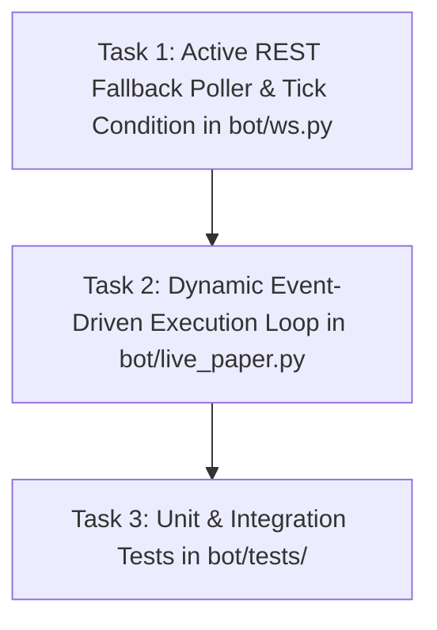

# Implementation Plan - Decouple Trade Execution Loop & Active 1-2s REST Fallback Polling

Branch: i6/decouple-trade-execution-loop | Issue: #6

## 1. Overview & Motivation
Historically, `dangerously-skip-permissions` logged fills with an empirical average frequency of ~5.5 seconds (~45 fills per 300s window). However, this cadence was an emergent property of market liquidity and quote fills, not an artificial metronome sleep.

Currently:
1. `LiveBookStreamer` only executes REST queries synchronously on-demand if a caller asks for price during disconnect/staleness, leaving the streamer in a passive state without streaming ticks or live book updates.
2. `bot/live_paper.py` contains hardcoded blocking sleeps (`time.sleep(5)` on misses/filters, and `time.sleep(left / remaining)` after fills), preventing real-time reaction to incoming price movements.

This refactor:
1. Adds an active background REST fallback polling thread to `LiveBookStreamer` (`bot/ws.py`) running every 1.0-1.5s when WebSocket is disconnected or stale (>3s). It keeps `TokenBook` fresh and streams `rest_poll` ticks to listeners and the dashboard UI.
2. Adds a thread-safe `wait_for_tick(timeout)` condition to `LiveBookStreamer` so execution loops wake up in microseconds whenever a new tick arrives (WS or REST fallback).
3. Replaces artificial blocking sleeps in `bot/live_paper.py` with responsive event-driven loop evaluations gated by tick arrival and minimum fill spacing (>=0.5s), reacting instantly to live prices while preventing runaway fills on a static book.

## 2. Architecture & Seams

### 2.1 `LiveBookStreamer` Seams (`bot/ws.py`)
- Add `rest_poll_interval: float = 1.0` to `LiveBookStreamer.__init__`.
- Add `self._tick_cond = threading.Condition(self._lock)` to notify waiting consumer loops whenever a tick (WS or REST fallback) is processed.
- Add `def wait_for_tick(self, timeout: float = 0.25) -> bool`: waits on `_tick_cond`.
- Add background fallback worker thread `_fallback_worker` started in `start()` and stopped in `stop()`.
- When `state != ConnectionState.CONNECTED` or `is_stale (>3s)`:
  - If `rest_fallback_client` is present, query `get_price(BUY)`, `get_price(SELL)`, and `get_midpoint` for both tokens.
  - Update `TokenBook` with timestamp `now` and `last_tick_ts = now`.
  - Append `StreamTick(event_type="rest_poll", ...)` to `self.ticks` and invoke `self.on_tick(tick)`.
  - Signal `self._tick_cond.notify_all()`.
  - Sleep for `rest_poll_interval` (interruptible via `_stop_event.wait(rest_poll_interval)`).

### 2.2 Execution Loop Seams (`bot/live_paper.py`)
- Remove blocking `time.sleep(5)` on `px is None`, `px < min_fill`, and M1-M3 extreme price skips. Replace with short non-blocking wait (`streamer.wait_for_tick(0.25)` or `time.sleep(0.1)`).
- Remove pacing calculation `time.sleep(max(2.0, min(20.0, left / max(remaining, 1))))`.
- Add dynamic fill gating:
  - Track `last_fill_ts` and `last_fill_tick_count`.
  - Require either a tick increment (`streamer.tick_count > last_fill_tick_count`), price change, or minimum fill spacing (>=0.5s) between fills on the same side, preventing instantaneous clip exhaustion on an unchanged tick.
  - After fill, wait up to 0.25s for next tick via `streamer.wait_for_tick(0.25)` before re-evaluating.

## 3. Dependency Graph & Tasks

### Task 1: Active REST Fallback Poller & Tick Condition in `bot/ws.py` [Backend/Logic]
- **Size**: M (1 file)
- **Files**: `bot/ws.py`
- **Depends on**: None
- **Details**:
  - Implement `_fallback_worker` thread and `_poll_rest_fallback` method.
  - Add `_tick_cond` and `wait_for_tick(timeout: float = 0.25) -> bool`.
  - Ensure thread-safe notification on WS ticks and REST fallback ticks.
  - Clean lifecycle: start and stop fallback thread properly.
- **Verification**: `python -m unittest bot/tests/test_ws.py`

### Task 2: Dynamic Event-Driven Execution Loop in `bot/live_paper.py` [Backend/Logic]
- **Size**: M (1 file)
- **Files**: `bot/live_paper.py`
- **Depends on**: Task 1
- **Details**:
  - Eliminate blocking 5s sleeps and artificial pacing sleeps.
  - Wire loop to `streamer.wait_for_tick(0.25)`.
  - Implement anti-runaway fill gating (minimum fill spacing and tick-count check).
  - Ensure risk checks, state sync, and logging remain 100% intact.
- **Verification**: `python -m unittest bot/tests/test_live_paper.py`

### Task 3: Comprehensive Unit & Integration Tests [Test]
- **Size**: S (2 files)
- **Files**: `bot/tests/test_ws.py`, `bot/tests/test_live_paper.py`
- **Depends on**: Task 1, Task 2
- **Details**:
  - Test active REST fallback polling cadence and tick generation when WS is disconnected/stale.
  - Test `wait_for_tick` notification on ticks.
  - Test responsive execution loop in `bot/live_paper.py` without 5s sleeps.
  - Full suite verification: `python -m unittest discover -s bot/tests`.
- **Verification**: `python -m unittest discover -s bot/tests` exits 0.
